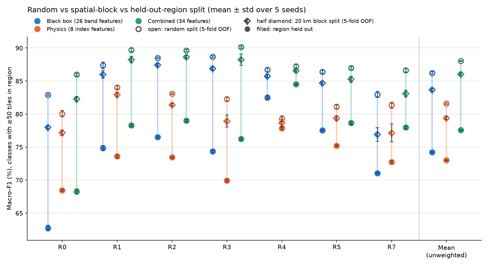
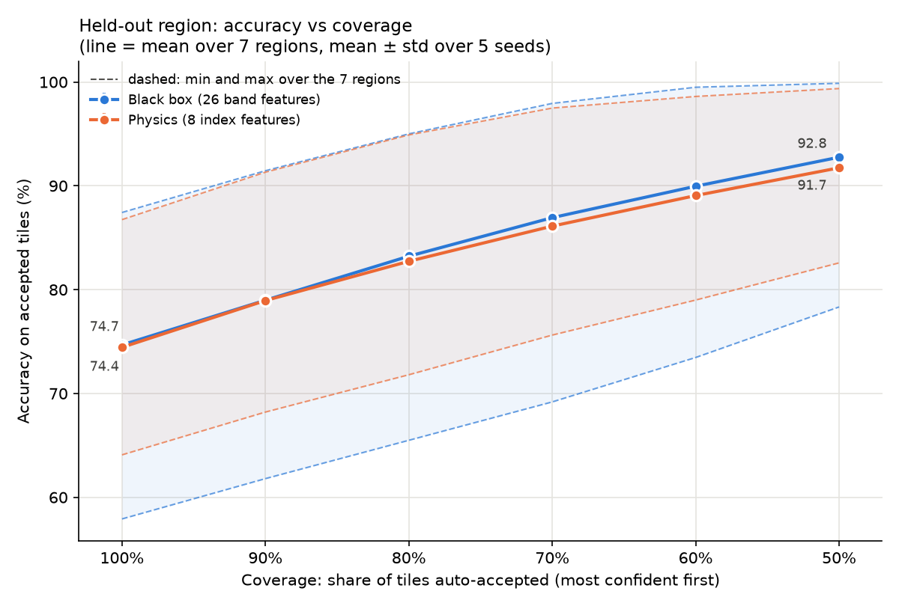
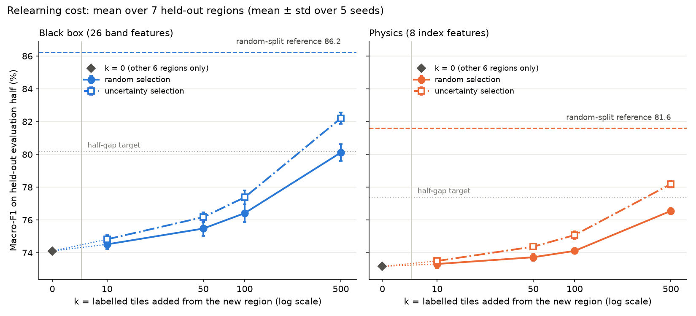

# eo-physics-vs-blackbox

**Question.** Land-use classifiers trained on satellite images from some European regions are often used on regions they have never seen. Do they still work there? And do physics-based spectral indices (NDVI, NDWI, NDBI, NDRE), which are built to measure surface properties rather than raw brightness, transfer to new regions better than the raw Sentinel-2 bands? This repository is a small benchmark on public data. It tests both questions with a deliberately simple model and evaluation splits that keep the regions separate.

## Headline results

Macro-F1 in %, mean over 7 held-out regions and 5 seeds. "Pairs" are the 35 seed × region combinations. They are correlated, not independent tests.

1. **The silent break.** A random train/test split overstates new-region macro-F1 by **12.0 points** for the raw-band model (86.2 → 74.2). The figures are 8.6 points for indices and 10.5 for combined features. A 20 km spatial-block split separates near-twin leakage from real region shift. Leakage is only **2.6 points (21%)** of the raw-band drop (19–26% across feature sets). The remaining **9.4 points** are region shift. Every pair still drops from block split to region split, for every feature set.
2. **Physics indices drop less, but are less accurate alone.** Index features drop less than raw bands in **35/35 pairs** (8.6 vs 12.0 points). Most of that difference is in the shift part (6.3 vs 9.4 points), not leakage. Alone they score lower on unseen regions (73.0 vs 74.2) and under the block split (79.4 vs 83.7).
3. **Combined features are best.** Bands + indices (34 features) reach **77.6** on unseen regions. They are best in **6 of 7 regions**; in the seventh (R0, Iberia) they tie with the indices, 68.3 vs 68.5. They beat the raw-band model in **35/35 pairs** (mean +3.3 points, range +0.9 to +7.3). They do not inherit the indices' stability: their drop (10.5) lies between the other two.
4. **Confidence flagging helps on average, but is weakest where it is needed most.** Flagging the 20% least-confident tiles on an unseen region catches **51%** of all errors (raw bands; 49% for indices), against 20% for random flagging. In the most shifted region (R0, largest drop) it catches only **34% / 37%**. The review load is uneven: 25–36% of crop and herbaceous tiles are flagged (Highway 39–43%), against 1–6% for SeaLake and Forest.
5. **Relearning: uncertainty-chosen labels beat random ones.** Adding labelled tiles from the new region helps more when the tiles are chosen by low confidence. At 500 labels this beats random choice in 33/35 (raw bands) and 35/35 (indices) pairs. With only 10–50 labels, uncertainty selection is close to random (it wins 20–26 of 35 pairs); the advantage appears as labels grow. Against the block-split reference, closing half the gap needs about **225** uncertainty-chosen labels per region for raw bands and **253** for indices. Random labels need about **367** and **454**. These counts are rough (about ±100; linear interpolation between k = 100 and 500).

## Data

[EuroSAT](https://zenodo.org/records/7711810), multispectral version (`EuroSAT_MS.zip`): Sentinel-2 Level-1C, **13 bands**, **27,000** georeferenced 64 × 64 px GeoTIFF tiles, **10** land-use classes.

- Helber, P., Bischke, B., Dengel, A., Borth, D. (2019). *EuroSAT: A Novel Dataset and Deep Learning Benchmark for Land Use and Land Cover Classification.* IEEE Journal of Selected Topics in Applied Earth Observations and Remote Sensing, 12(7), 2217–2226. doi:10.1109/JSTARS.2019.2918242
- Helber, P., Bischke, B., Dengel, A., Borth, D. *EuroSAT* [dataset]. Zenodo. doi:10.5281/zenodo.7711810
- **Licence:** the Zenodo record lists the dataset under the **MIT License**.

No imagery is stored in this repository. Small derived tables (tile coordinates, regions and 20 km blocks) are included so the tests run without the raw data. To download (2.07 GB):

```bash
mkdir -p data/raw
curl -L -o data/raw/EuroSAT_MS.zip "https://zenodo.org/records/7711810/files/EuroSAT_MS.zip?download=1"
md5sum data/raw/EuroSAT_MS.zip   # expect 091174add3c8e680a49244acf185b9f0
unzip -q data/raw/EuroSAT_MS.zip -d data/raw   # -> data/raw/EuroSAT_MS/<Class>/<Class>_<n>.tif
# without unzip:
python -m zipfile -e data/raw/EuroSAT_MS.zip data/raw
```

## Method

- **Regions.** Each tile's centre is reprojected to WGS84. K-means (k = 8) runs on (lat, lon), and clusters are numbered west to east. R6 (Finland/Baltics, 774 tiles, 6 classes with < 50 tiles) was merged into R4, which leaves **7 regions**: R0, R1, R2, R3, R4, R5, R7 (no R6). Map: `figures/regions_map.png`.
- **Feature sets** (per tile, mean and standard deviation over the 64 × 64 pixels):
  - *black box*: 13 raw bands → **26** features;
  - *physics*: NDVI, NDWI, NDBI, NDRE → **8** features;
  - *combined*: both → **34** features.
- **Model.** `RandomForestClassifier(n_estimators=500)`, scikit-learn defaults, the same for all feature sets. Relearning uses 200 trees to save runtime.
- **Evaluation on the same tiles.** Each region is scored on exactly the same tiles under three splits:
  - *random split*: out-of-fold predictions from a class-stratified random 5-fold split over all data;
  - *20 km block split*: 5-fold `GroupKFold` over 20 km × 20 km equal-area (EPSG:3035) blocks, 2,331 blocks;
  - *leave-one-region-out*: train on the other 6 regions.

  Random − block = near-twin leakage; block − region = region shift.
- **Metric.** Macro-F1 averaged over the classes with **≥ 50 tiles** in the held-out region. All tiles are kept, so predictions of rare classes still count as errors. Accuracy is reported alongside. Results are the mean ± std over **5 seeds** (0–4), each the unweighted mean over the 7 regions. Seed std (≤ 0.6 points for the region split, ≤ 1.4 for the block split) measures model and fold randomness, not uncertainty over regions.
- **Confidence** = the highest class probability. **Relearning:** each held-out region is split 50/50 into a label pool and an evaluation half. k ∈ {0, 10, 50, 100, 500} pool tiles are added to training, chosen at random or by lowest confidence (one shot).

## Figures

| | |
|---|---|
|  | Per-region macro-F1 under the random, 20 km block and leave-one-region-out splits, for all three feature sets (steps 4, 7, 8). |
|  | Accuracy on the X% most confident tiles of an unseen region (region split). |
|  | Macro-F1 on an unseen region as k of its labelled tiles are added, random vs uncertainty selection. |

## Sanity checks

| Check | What was done | Result |
|---|---|---|
| Band order proved from data | The files carry no band names. All bands are resampled to 10 m, so bands sensed at coarser resolution are spatially smoother. Roughness (mean neighbour difference / std) was measured per band position. | Three tiers match Sentinel-2 exactly: ≈ 0.30 (10 m), ≈ 0.15 (20 m), ≈ 0.08–0.10 (60 m). Band 10 ≈ 10 DN (cirrus), band 13 r = 0.996 with B07. Order: **B01–B12, then B8A last** (not after B08). This matches the band order in the TorchGeo EuroSAT loader. |
| NDVI/NDWI per class | Class means of tile-mean NDVI and NDWI. | Forest (0.71) and Pasture (0.65) have the highest NDVI and Industrial (0.22) is low. SeaLake has the lowest NDVI (−0.25) and is the only class with positive NDWI (0.46). |
| Class mix per region | Region × class counts. | Only R2 and R3 have ≥ 50 tiles of every class (R1 has no Forest or PermanentCrop). This led to the R6 merge and the per-region ≥ 50-tile class list for macro-F1. |
| Evaluation design | Random-split scores were taken from the out-of-fold predictions for the held-out region's own tiles and scored on the same class list. Later steps assert that they reproduce the saved step-4 table. | Every split is compared on identical tiles and classes. No-skill baseline macro-F1 is 0–4.3 in every region. |
| Download checksum | MD5 of `EuroSAT_MS.zip`. | `091174add3c8e680a49244acf185b9f0`, matches the Zenodo record. |
| Block-edge leakage | Nearest-neighbour distance between tile centres (tiles are 640 m wide). | The nearest neighbour lies in the same block for 90.7% of tiles. **3.9%** have a neighbour < 2 km away in another block, so the block split still leaks a little. |

## Limitations

- **Simple model, public data.** A random forest on per-tile mean/std summaries, chosen so that the comparison is about inputs, not model capacity. Deep models may behave differently.
- **Small physics set.** Only four normalized-difference ratio indices. Ratios discard overall brightness, which is part of why they are stable and part of why they are less accurate alone.
- **Narrow scope.** 7 regions (n = 7 for anything said about regions); each tile is a single acquisition, and seasonal or cross-sensor effects were not tested; top-of-atmosphere (Level-1C) reflectance with no atmospheric correction.
- **Uncalibrated confidence.** RF probabilities are tree-vote fractions. The model is underconfident in every group tested, and all threshold-based numbers depend on that.
- **Leakage estimate.** 2.0–2.6 points is a **lower bound**, because of edge leakage across block borders. Only 20 km blocks were tested; larger blocks would move some "shift" into "leakage".

## Next steps

- A richer physics set, fixed from theory **before** testing: dark-object haze correction, SAVI, Tasseled Cap, MNDWI, NBR.
- Tests across seasons and across sensors.
- Calibrated confidence (e.g. on held-out regions) before flagging.
- Combined features in the relearning curve.
- A small CNN baseline on the same splits.

## How to reproduce

Python 3.14. Total runtime is about 2 hours on 8 cores; the longest steps are noted.

```bash
python -m venv .venv && .venv/bin/pip install -r requirements.txt
# download and unzip the data as in "Data" above

PY=".venv/bin/python -I"
$PY scripts/inspect_eurosat.py data/raw/EuroSAT_MS   # step 1: tile and class counts
$PY scripts/make_regions.py                          # step 2: data/metadata.csv, regions map
$PY scripts/make_features.py                         # step 3: data/features.csv
$PY scripts/step4_compare.py                         # step 4: random vs region split (~17 min)
$PY scripts/step5_confidence.py                      # step 5: confidence, flagging
$PY scripts/step5_figure.py
$PY scripts/step5_flag_by_class.py
$PY scripts/step6_relearn.py                         # step 6: relearning (~65 min)
$PY scripts/step6_analyze.py
$PY scripts/step7_combined.py                        # step 7: combined features (~24 min)
$PY scripts/step7_analyze.py
$PY scripts/step8_blocks.py                          # step 8: 20 km blocks
$PY scripts/step8_block_split.py                     # (~12 min)
$PY scripts/step8_analyze.py
$PY scripts/step8_figure.py                          # final figures/random_vs_region.png
pytest tests/
```

`step4_figure.py` and `step7_figure.py` make earlier versions of `figures/random_vs_region.png`. Running them after step 8 overwrites the final figure. Step-by-step decisions and all intermediate numbers are in `NOTES.md`.

## Licence

Code: MIT (see `LICENSE`). Data: EuroSAT, MIT, by its authors (see Data).

Built with Claude Code; the study design, decisions and checks are mine.
